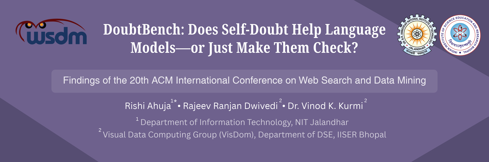

<p align="center">
  
</p>

# DoubtBench: Does Self-Doubt Help Language Models—or Just Make Them Check?

[](https://rishia.in/pub/ahuja2027doubtbench)

**Accepted to WSDM 2027 Findings.**

Rishi Ahuja<sup>1</sup> · Rajeev Ranjan Dwivedi<sup>2</sup> · Vinod K. Kurmi<sup>2</sup>

<sup>1</sup> Department of Information Technology, NIT Jalandhar<br>
<sup>2</sup> Visual Data Computing Group (VisDom), Department of Data Science and Engineering, IISER Bhopal

[Project page](https://rishia.in/pub/ahuja2027doubtbench) · [Supplementary material](supplementary/supplement.pdf)

---

## About the paper

DoubtBench studies whether self-doubt wording improves language-model accuracy beyond a direct instruction to check the work. It holds the task, gold answer, checkpoint, and decoding setup fixed while varying the prompt. The benchmark contains **6,400 exact-answer tasks across eight families and 33 task types**, evaluated under five prompt conditions and two contexts: a minimal task request and a request for intermediate reasoning.

The central measure, the **Conditional Doubt Effect (CDE)**, compares accuracy under self-doubt + check with accuracy under check alone. Across **423,600 responses from six checkpoints**, overall CDE ranges from **−1.43 to +2.59 percentage points**. Four checkpoints show positive incremental effects under minimal requests; only two do when intermediate reasoning is already requested. The findings show that the value of the tested self-doubt wording depends on the checkpoint, task family, existing instructions, and surface form.

For evaluation and reproduction, see the [usage guide](USAGE.md). Task construction, prompts, and scoring are described in the [benchmark protocol](BENCHMARK.md); reported effects and tables are explained in the [results guide](results/README.md).

## Citation

```bibtex
@inproceedings{ahuja2027doubtbench,
  title     = {{DoubtBench}: Does Self-Doubt Help Language Models---or Just Make Them Check?},
  author    = {Ahuja, Rishi and Dwivedi, Rajeev Ranjan and Kurmi, Vinod K.},
  booktitle = {Findings of WSDM 2027},
  year      = {2027},
  note      = {Accepted for publication},
  url       = {https://rishia.in/pub/ahuja2027doubtbench}
}
```
